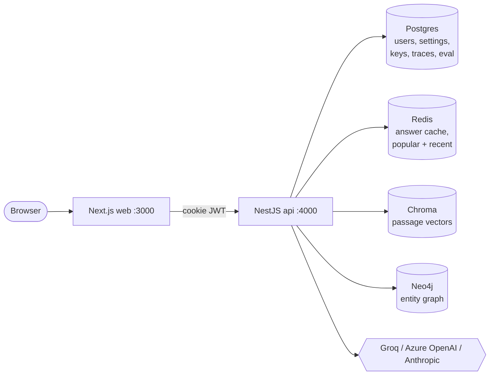
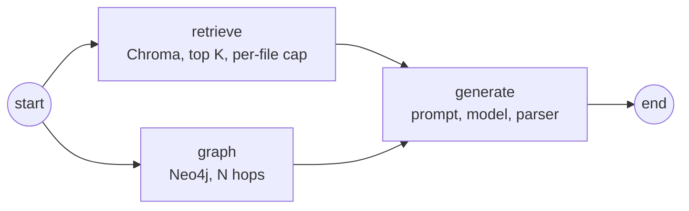

# AI Knowledge Assistant

A retrieval-augmented chat assistant with a **knowledge graph**, built on **LangChain and LangGraph**, and
managed entirely from an **admin area** (no code or config edits to change its name, prompt, model, retrieval
settings or who can sign in).

Users sign in with Google, upload documents, and ask questions. Each answer is built from two retrievers that run
in parallel: vector search over document passages (Chroma) and a graph walk over entities extracted from the same
documents (Neo4j). Question like *"Which technologies are used by projects Northwind Analytics people worked on?"*
need facts that sit in different documents; the graph supplies the links that vector search alone cannot.

## Highlights

| | |
|---|---|
| **GraphRAG** | An LLM extracts entities and relationships (structured output) into Neo4j on upload. At question time the graph is walked N hops from entities named in the question, and the facts are added to the prompt. Answers show which graph facts were used. |
| **LangGraph flow** | The answer pipeline is an explicit state graph: `retrieve` and `graph` run in parallel, then `generate`. |
| **Multi-provider** | Groq, Azure OpenAI and Anthropic behind one `BaseChatModel` interface, switchable per question. Keys are AES-256-GCM encrypted. Remaining rate-limit headroom is shown as a badge. |
| **Answer cache** | Repeated questions are served from Redis with no vector search and no LLM call. Popular and recent question lists in the sidebar. Cache entries are versioned and cleared automatically when documents, models or answer-affecting settings change. |
| **Admin area** | Branding, system prompt, temperature, answer length, retrieval size, chunking, graph depth, cache lifetime, feature switches, provider keys and models, invites and roles. Changes apply to the next request. |
| **Observability** | A LangChain callback records latency, token counts and errors for every model call. An in-app Usage tab shows them. Optional LangSmith tracing by environment variable. |
| **Evaluation** | Test questions with expected answers run through the real pipeline; an LLM judge grades each reply for correctness and groundedness (structured output). Runs are stored so they can be compared after a change. |
| **Whole stack in Docker** | Postgres, Redis, Chroma, Neo4j, plus Dockerfiles for the api and web. |

## Architecture



The question-answering flow (`apps/api/src/chat/rag-graph.ts`):



Before the flow runs, `ChatService` checks the Redis answer cache. A hit skips the flow entirely.

### How the knowledge graph is built and used

1. **Upload:** the file is parsed, split into heading-aware chunks and embedded into Chroma. The upload returns.
2. **Extract (background):** the chunks go to the first active provider, three at a time, with a zod schema
   (`withStructuredOutput`). The result is a list of triples such as *Sara Ahmed, works at, Northwind Analytics*.
   If a model cannot do structured output, a raw-JSON fallback parses the reply by hand.
3. **Store:** entities become Neo4j nodes (merged by lowercase name); the verb becomes the relationship type
   (`WORKS_AT`). Every relationship stores the file it came from, so deleting a document removes exactly its facts.
4. **Ask:** entities named in the question are matched, and the graph is walked up to N hops (default 2, capped at
   25 facts). The facts are placed in the prompt next to the retrieved passages.

Neo4j is optional. With `NEO4J_URI` unset, or Neo4j down, the graph step returns nothing and the assistant behaves
as plain RAG.

## The admin area

Open **Admin** (admins only). The first person to sign in to a fresh install becomes the admin, so there is no
setup file to edit.

| Tab | What you can change |
|---|---|
| **General** | App name, tagline, accent colour (applied across the whole UI), and who may sign in (`invite-only` or `open`). |
| **Models & prompt** | Add, switch on/off, edit the model of, test and delete provider keys. System prompt, temperature, maximum answer length. |
| **Knowledge** | Passages sent to the model, passages per file, chunk size and overlap, graph depth and fact cap, cache lifetime, how many top questions are pre-answered. |
| **Features** | Switch the answer cache, the question lists, GraphRAG and the usage badges on or off. |
| **Users** | Invite people by email with a role, revoke invites, change roles, remove users. The last admin cannot be demoted. |
| **Usage & quality** | LLM calls, latency, tokens and failures; and the evaluation runner. |

Settings are defined once in `apps/api/src/settings/settings-registry.ts` (key, label, type, range, default). The
admin form is generated from those definitions, so a new setting needs one registry entry and one read where it is
used. Only overrides are stored, so a fresh install behaves exactly as the defaults say.

## LangChain and LangGraph in this project

| Concept | Where |
|---|---|
| `StateGraph` with parallel nodes and a join | `chat/rag-graph.ts` |
| Custom `BaseRetriever` over Chroma | `documents/knowledge-base-retriever.ts` |
| LCEL chain `ChatPromptTemplate -> model -> StringOutputParser` | `chat/rag-graph.ts` |
| One `BaseChatModel` interface over three providers | `chat/provider-factory.service.ts` |
| Structured output with a zod schema (extraction, grading) | `graph/graph-extractor.service.ts`, `eval/eval.service.ts` |
| Callback handler for latency, tokens and errors | `tracing/llm-trace.handler.ts` |
| LLM-as-judge evaluation over the real pipeline | `eval/eval.service.ts` |

## Run it

Needs Node 24 and Docker Desktop. Full steps and troubleshooting are in [HOW_TO_RUN.txt](./HOW_TO_RUN.txt).

```bash
npm install                       # also generates the Prisma client
cp .env.example .env              # fill in the REPLACE_ME values (Google OAuth, two secrets)
docker compose up -d              # Postgres, Redis, Chroma, Neo4j, Adminer
cd apps/api && npx prisma migrate deploy && cd ../..
npx turbo run dev                 # api :4000 and web :3000
```

Or run everything in containers:

```bash
docker compose --profile app up -d --build
```

Then open http://localhost:3000, sign in, open **Admin**, add a provider key under **Models & prompt**, upload the
two files in `samples/graphrag/`, and ask: *"Which technologies are used by projects that Northwind Analytics people
worked on?"*

### Configuration

Only secrets and addresses live in `.env` (see `.env.example`): database, Redis, Chroma and Neo4j addresses, the JWT
secret, the Google OAuth client, and the key that encrypts stored provider keys. Everything else is an admin
setting.

## Project structure

```
apps/
  api/                NestJS backend
    prisma/           schema and migrations
    src/
      auth/           Google OAuth, JWT cookie, admission rules, role guard
      users/          list, delete, roles, invites
      providers/      encrypted key vault, usage headers, model config, connection test
      documents/      upload, extraction, chunking, Chroma, retriever
      chat/           the LangGraph flow, answer cache wiring, provider factory
      graph/          entity extraction, Neo4j store, graph lookup
      faq/            Redis: cache, popular and recent questions
      settings/       admin-editable values and their registry
      features/       on/off switches
      tracing/        LangChain callback handler and usage stats
      eval/           test questions, runs, LLM judge
  web/                Next.js frontend (chat at /, admin at /admin)
packages/shared-types TypeScript types shared by both apps
samples/graphrag/     two small linked documents for trying GraphRAG
```

## Tests

```bash
cd apps/api && npx jest           # 179 tests in 12 suites, no Docker, network or API key needed
```

Every external dependency is faked. The chat tests fake only the model (`FakeListChatModel`), so the real prompt,
the real LangGraph flow and the real output parser run. The suites cover the answer flow and cache, retrieval and
chunking, settings validation and cache invalidation, feature flags, login admission rules, role and invite rules,
the tracing handler, the evaluation helpers, and graph parsing and Cypher safety.

Request bodies are validated with a global `ValidationPipe` (chat messages are capped at 4,000 characters),
uploads at 20 MB, and the api is rate-limited per IP (120 requests/minute, 20/minute for chat, where every
request is a paid LLM call).

## CI/CD

[.github/workflows/ci.yml](./.github/workflows/ci.yml) is a two-stage pipeline:

1. **checks** — on every push and pull request: type-checks both apps (regenerating the Prisma client and the
   Next.js route types first) and runs the full test suite. Needs no Docker, network or API key, which is what
   makes the suite CI-friendly.
2. **publish-images** — on pushes to `main` only, and only after `checks` passes (`needs: checks`, so a commit
   that fails tests can never become an image): builds the api and web Docker images in parallel from the
   existing Dockerfiles and pushes them to GitHub Container Registry, tagged `latest` and with the commit SHA.
   The SHA tag is immutable, so a rollback is redeploying an old tag. Authentication is the workflow's own
   short-lived `GITHUB_TOKEN` with job-scoped `packages: write` — no stored secrets.

```bash
docker pull ghcr.io/mohamedraiyans/ai-knowledge-assistant-api:latest
```

```bash
docker pull ghcr.io/mohamedraiyans/ai-knowledge-assistant-web:latest
```

The images carry the application, deliberately not its configuration: running one needs `DATABASE_URL`, Redis
and the other `.env` values injected at runtime, plus the backing services (`docker-compose.yml` shows the
wiring). This is continuous *delivery* — every green commit on `main` produces a deployable artifact. A deploy
job that pulls the images onto a host (`docker compose pull && up -d` over SSH) is the designed next step.

## Design decisions

- **Retrieval stays a separate step.** The retrieved passages (with file name and score) are needed on their own for
  citations and the cache entry, so retrieval is a graph node rather than hidden inside one chain.
- **Reasoning models need headroom.** `openai/gpt-oss-120b` spends its token limit on thinking before it writes the
  answer. A 512-token limit gave an empty reply, so extraction and grading use their own larger limits.
- **LLM output is untrusted.** Relationship names from the model are reduced to `A-Z`, digits and `_` before they
  go into a Cypher query, because Cypher cannot parameterise a relationship type.
- **Cache correctness over cache hits.** A blank reply is never cached, and anything that changes what an answer
  says (documents, model, system prompt, retrieval or graph settings) clears the cache with a single counter bump.
- **No lock-out.** The last admin cannot be demoted, and anyone who already has an account can always sign in.

## Known limits

- Entity matching is by exact name inside the question, so "Sara" does not match "Sara Ahmed". Entity resolution
  (merging aliases and spelling variants) is the next improvement.
- Extraction quality depends on the model. There is no fixed schema of allowed entity or relationship types, and
  the model occasionally invents a node.
- All signed-in users share one knowledge base (roles control admin access, not document visibility).
- The graph is viewed in Neo4j Browser; the web app lists the facts used per answer but has no graph screen.
- Conversation memory is in-process and resets when the api restarts.
- The api image keeps the full dependency tree so it can run Prisma migrations at start; slimming it is a follow-up.
